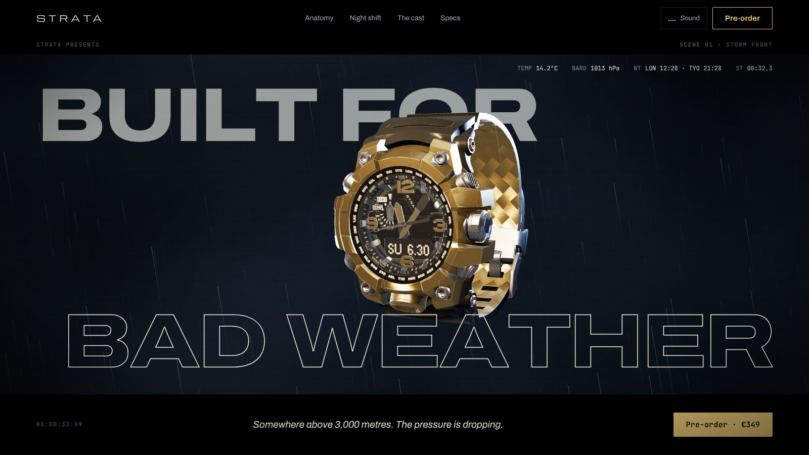
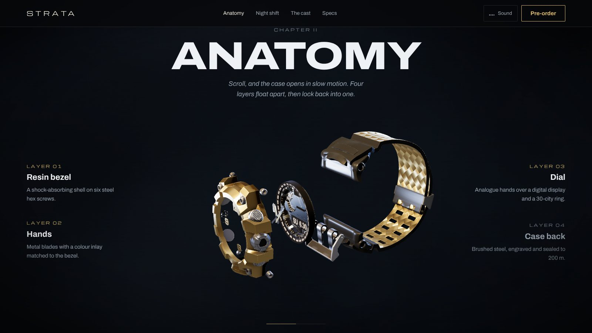
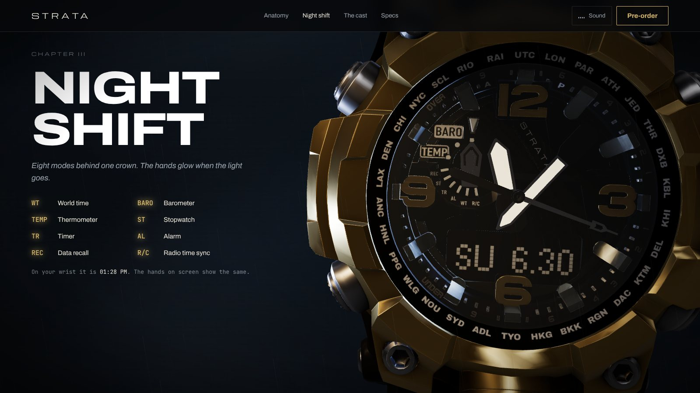
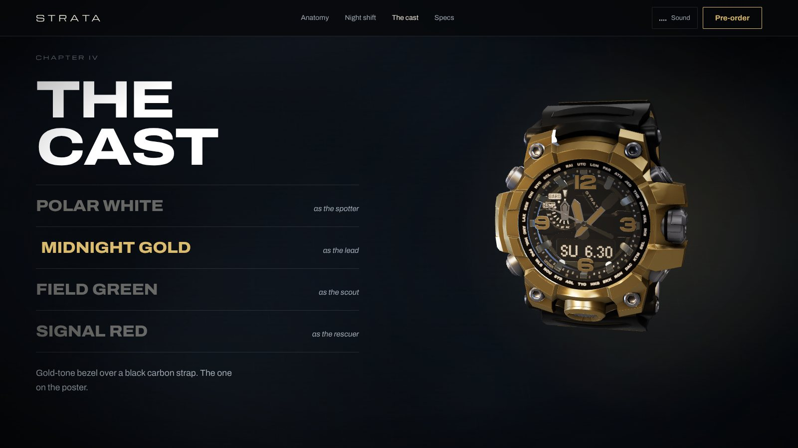
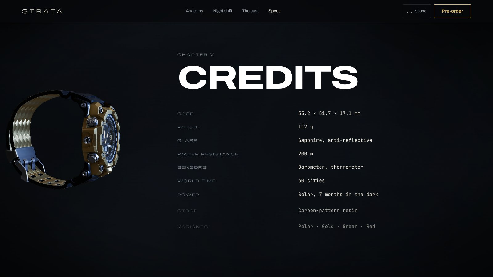
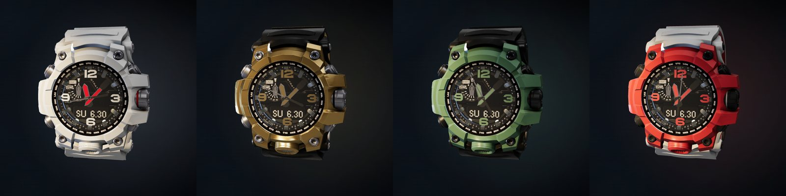
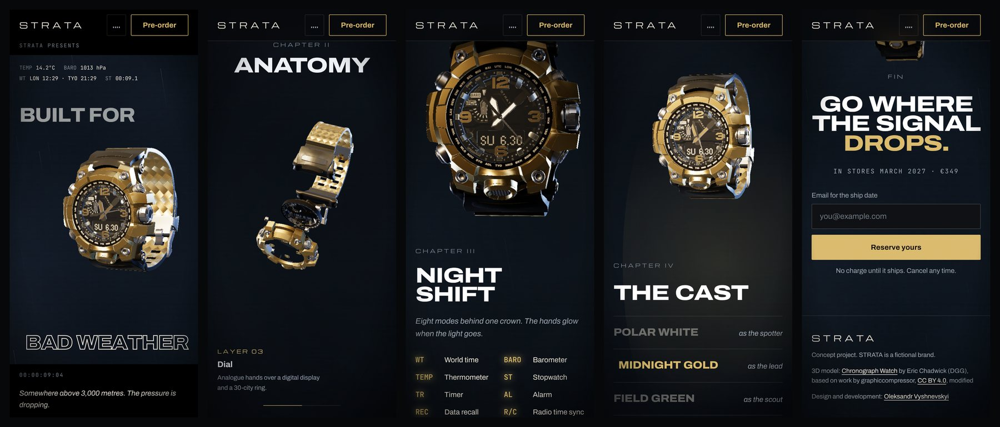

# STRATA S-01 — cinematic 3D product landing

A concept landing page for a fictional rugged field chronograph, told as a short film in five chapters. Real-time WebGL, scroll-driven camera work, weather, sound and a live colour switcher, all on a single page.

**[Live demo](https://oleksandr549.github.io/Strata.github.io/)** · Concept, design and development by [Oleksandr Vyshnevskyi](https://vyshnevsky.com)




| Anatomy | Night shift |
| --- | --- |
|  |  |
| **The cast** | **Credits** |
|  |  |

**Four colour variants, switched live on the 3D model**



**On a phone**



## Highlights

- One continuous 3D scene that follows the scroll through five chapters, with no page reloads or video files
- Real-time PBR watch whose hands show the visitor's local time
- Exploded view, macro dolly and colour switching all driven by the same scroll story
- Works without WebGL and respects reduced-motion settings
- 21 automated tests, including accessibility checks with axe-core

## What it does

- **Opening shot.** Shutters open into a 2.39:1 letterbox with a running timecode, film subtitle and live instrument readout (world time in London and Tokyo, a running stopwatch).
- **Real-time 3D watch.** A PBR glTF model lit like a film set: warm key, cool rim lights, fog layers and GPU rain streaks drawn as one draw call.
- **The hands tell your time.** Hour, minute and second hands are driven by the visitor's local clock, with a tick on the second hand.
- **Anatomy.** A pinned chapter where scrolling pulls the case apart into four layers and locks it back together, with callouts that follow the progress.
- **Night shift.** The camera dollies into the dial, lights drop and the hand inlays glow.
- **The cast.** Four colour variants from the model's `KHR_materials_variants`, switched with a spin and light flash. The accent colour of the whole page follows the chosen variant.
- **Credits.** Specs styled as end credits over a slowly turning side profile.
- **Ambient sound.** Optional rain and distant thunder synthesised with the Web Audio API, no audio files. Rain volume follows the weather in each chapter.
- **Reserve form.** Client-side validation with inline, screen-reader friendly messages.

## Stack

- [Vite](https://vitejs.dev/) with plain ES modules, no framework
- [Three.js](https://threejs.org/) r169 with meshopt-compressed glTF
- [GSAP](https://gsap.com/) + ScrollTrigger for the intro and reveals
- [Lenis](https://lenis.darkroom.engineering/) for smooth scrolling
- [Playwright](https://playwright.dev/) + [axe-core](https://github.com/dequelabs/axe-core) for end-to-end and accessibility tests

## Performance

- The model was reduced from 7.9 MB to **2.2 MB** (desktop, 2048 px textures) and **1.6 MB** (phones, 1024 px textures) with meshopt geometry compression and WebP textures. Phones get the lighter file automatically.
- Three.js is split into its own chunk and loaded on idle, after the first paint. The page itself ships about 60 KB of gzipped JS before 3D.
- The hero still frame is a preloaded, responsive AVIF/WebP image, so the first paint never waits for WebGL. The 3D scene cross-fades in once ready.
- Shaders compile asynchronously (`compileAsync`) for every colour variant up front, so switching colours never stutters.
- Pixel ratio is capped (1.75 desktop, 1.5 phones). A frame-time monitor drops resolution and halves the rain on slow GPUs.
- Rendering stops when the tab is hidden. The glass uses a cheap transparent material instead of a second transmission pass.
- Fonts are self-hosted WOFF2 files subset to Latin (Archivo variable, Michroma, JetBrains Mono). No third-party requests, which also keeps it GDPR-friendly.
- Off-screen still frames are dropped once WebGL takes over, so 3D visitors never download both.

Lighthouse, desktop, on a real GPU:

| Performance | Accessibility | Best Practices | SEO |
| --- | --- | --- | --- |
| 98 | 100 | 96 | 100 |

First Contentful Paint 0.6 s, Largest Contentful Paint 0.8 s, Total Blocking Time 90 ms, Cumulative Layout Shift 0.

## Accessibility and fallbacks

- `prefers-reduced-motion` or `Save-Data`: no WebGL, no smooth scroll, no scroll-driven motion. Every chapter shows a pre-rendered still frame instead.
- Browsers without WebGL get the same still-frame version.
- Skip link, visible focus states, semantic landmarks and headings.
- The colour switcher is a proper `radiogroup` with arrow keys, Home and End.
- Form errors set `aria-invalid` and are announced through a live region.
- Colour contrast meets WCAG AA everywhere, including the dimmed callouts.

## Project structure

```
index.html            page markup and meta
404.html              "signal lost" page
src/main.js           boot, intro, scroll, UI, form, sound toggle
src/scene.js          Three.js scene: lights, model, variants, rain, fog
src/story.js          maps scroll position to camera and lighting states
src/audio.js          Web Audio rain and thunder
src/styles.css        all styles
public/models         compressed glTF models (HD and SD)
public/img            AVIF/WebP still frames rendered from the model
public/fonts          subset WOFF2 fonts
tests/                Playwright end-to-end and accessibility tests
```

## Scripts

```bash
npm install
npm run dev       # local dev server
npm run build     # production build into dist/
npm run preview   # serve the build on http://localhost:4173
npm test          # build, serve and run the Playwright suite (21 tests)
```

The first test run needs a browser: `npx playwright install chromium`.

## Opening the build locally

`dist/index.html` will not work if you double-click it. Browsers block ES modules, web fonts and the 3D model on `file://` pages for security reasons, so the page needs a local web server:

```bash
npm run preview            # from the project folder
npx serve dist             # or, with only the dist folder
python -m http.server 8080 # or Python, run inside dist, then open http://localhost:8080
```

In VS Code, the Live Server extension works too.

## Deploy

The repository includes a GitHub Actions workflow (`.github/workflows/deploy.yml`) that builds the site and publishes it to GitHub Pages on every push to `main`. Enable it once in **Settings → Pages → Source: GitHub Actions**.

`dist/` is a static site with relative paths, so it works on Vercel, Netlify, Cloudflare Pages or GitHub Pages, including a sub-folder. Enable gzip or Brotli on the host (on by default on the first three) and long cache headers for `assets/`, `models/`, `img/` and `fonts/`.

## How the model was prepared

1. Took the Chronograph Watch sample model from the Khronos glTF sample library.
2. Replaced every logo on the dial, case back and clasp with the fictional STRATA mark by editing the textures, and renamed the colour variants.
3. Compressed it with glTF-Transform (meshopt, WebP, 2048 and 1024 px texture sets).
4. Rendered the still frames and Open Graph image from the same model in headless Chromium with the site's lighting.

## Credits

- **3D model:** [Chronograph Watch](https://github.com/KhronosGroup/glTF-Sample-Assets/tree/main/Models/ChronographWatch) by Eric Chadwick, © Darmstadt Graphics Group GmbH, licensed under [CC BY 4.0](https://creativecommons.org/licenses/by/4.0/). Based on "Chronograph Watch Mudmaster" by graphiccompressor, CC BY 4.0. Modified: original logos removed and replaced with fictional branding, textures recompressed.
- **Fonts:** Archivo, Michroma and JetBrains Mono, under the SIL Open Font License 1.1 (license files in `public/fonts`). Subset to Latin for the web; none of them declares a Reserved Font Name.
- **Libraries:** Three.js, Lenis and Vite (MIT), GSAP (GreenSock standard no-charge license).
- **Concept, design and development:** [Oleksandr Vyshnevskyi](https://vyshnevsky.com).

STRATA is a fictional brand and is not affiliated with any watch maker. The source sculpt resembles an existing rugged watch design; this is a non-commercial design and development study, not a product for sale. Specifications and prices are part of the concept. Code is released under the MIT License; the model and fonts keep their own licenses.
